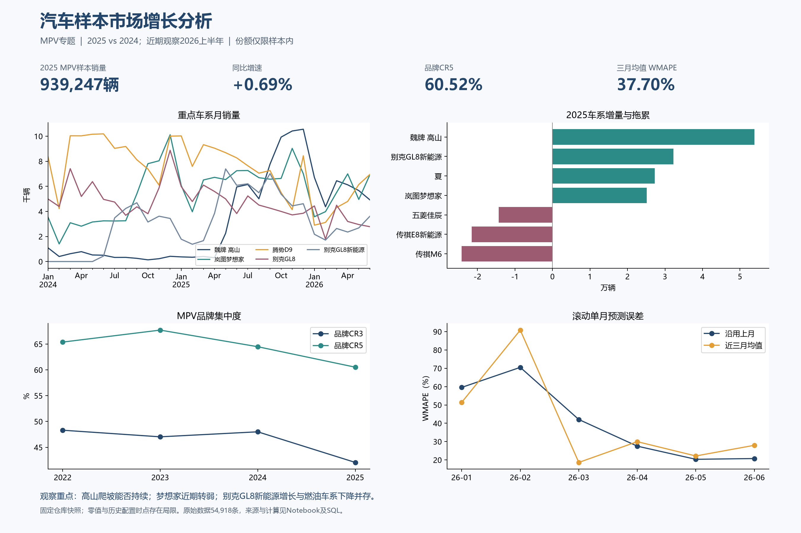

# 汽车市场竞争与增长分析

**个人数据分析项目 · Python / MySQL / Excel**

围绕三个问题展开：样本中哪些品牌和车系在增长？增长来自哪些产品？这种增长是否持续？

本项目参考 [Yemyu/china-auto-market-analysis](https://github.com/Yemyu/china-auto-market-analysis) 的公开销量与配置快照，缩小范围开展品牌增长与 MPV 专题分析。属于 AI 辅助完成的个人复现与分析项目，不代表真实公司任职或商业项目落地。

## 先看成果

- [五页分析报告](汽车样本市场分析报告.pdf)
- [Excel 看板](汽车市场分析看板.xlsx)：包含可编辑图表、品牌指标、MPV 车系、月度数据和核验记录。
- [已执行 Notebook](汽车样本市场分析.ipynb)
- [完整 Python 分析](analysis_main.py)
- [MySQL 建表与分析视图](sql/analysis.sql)



## 核心发现

| 问题 | 样本内结果 | 解读边界 |
|---|---|---|
| 哪些品牌在增长？ | 2025 年吉利银河较 2024 年增加 580,640 辆，小鹏增加 184,142 辆 | 品牌沿用来源名称，不按汽车集团合并 |
| MPV 增长来自哪些产品？ | 2025 年高山增加 53,816 辆，GL8 新能源增加 32,225 辆，梦想家增加 25,131 辆 | 产品增量不能解释购买动机或客户迁移 |
| 增长是否持续？ | 高山 89.4% 的全年增量来自下半年；梦想家 2026 年上半年同比下降 13.8% | 同时观察季度增量、增长月份与近期同比 |
| 竞争格局如何变化？ | 2025 年样本 MPV 销量同比 +0.69%，品牌 CR5 为 60.52%，同比下降 3.96 个百分点 | 不等同于全中国汽车市场份额 |
| 简单预测是否有效？ | 三个月均值 WMAPE 37.70%，上月值 39.36% | 均值方法仅在 6 个测试月中的 2 个月更好 |

## 数据与口径

- 54,918 条车系月度销量，1,017 个车系、162 个品牌；时间覆盖 2022-01 至 2026-06。
- 2,084 条配置记录；按标准化车系名称匹配 379 个销量车系。跨来源的 ID 不直接连接。
- 销量主键为车系 ID × 月份，重复键和日历网格缺口均为 0。
- 保留 38,693 条零销量和 568 条异常波动候选。零值可能混有采集空缺；异常标记不等于错误记录。
- 定向核对 5 个车系的 13 条来源记录，全部一致；不能据此推断全量数据准确率。
- 比较期为 2025 全年对 2024 全年、2026 年 1—6 月对 2025 年 1—6 月；同比零基数返回空值。
- 配置是具体车型的静态画像，不能解释全车系历史能源销量结构。
- 原始快照 commit：`135dbf3483403b69b9626f39a9ca5ce091ce6c73`；文件校验值见 [source_manifest.json](data/source_manifest.json)。

## 复现方法

建议 Python 3.12、MySQL 8.0+。在本项目根目录运行：

```text
python -m venv .venv
```

激活虚拟环境后：

```text
python -m pip install -r requirements.txt
python analysis_main.py
```

主脚本重新生成清洗表、分析 CSV 与 Python 图表；不需要数据库即可运行默认流程。Windows 自动使用微软雅黑；其他系统应安装可用中文字体以免图表缺字。

在 VS Code 中打开项目根目录，再打开 Notebook 并选择相应 Python 环境。报告与 Excel 为已生成的交付物，主脚本不会重新生成它们。

MySQL Workbench 中先执行 `sql/analysis.sql`，再对空项目表执行 `sql/data_import.sql`。默认新建数据库 `auto_market_learning_20261018`。导入不能重复执行，否则会产生主键冲突。可运行：

```sql
USE auto_market_learning_20261018;
SET SESSION div_precision_increment=12;
SELECT * FROM v_brand_period
WHERE scope='MPV' AND comparison='FY2025'
ORDER BY delta DESC;
SELECT * FROM v_series_contribution
WHERE scope='MPV' AND comparison='FY2025' AND brand='别克'
ORDER BY delta DESC;
```

可选 `python analysis_main.py --mysql` 会向项目数据库加载数据并核对结果，应仅用于独立的学习数据库。连接参数使用 `AUTO_MYSQL_HOST`、`AUTO_MYSQL_PORT`、`AUTO_MYSQL_USER`、`AUTO_MYSQL_PASSWORD` 环境变量，默认端口 3308；不要把实际密码提交到仓库。

## 验证与文件组织

MySQL 8.0.46 已实际执行；50 项 Python / SQL 指标对账通过，并完成空库导入复核。详细记录位于 `results/mysql_python_reconciliation.csv` 和 `results/sql_restore_validation.json`。

```text
data/raw/          固定来源快照
data/processed/    事实表、维表与配置匹配
data/source_evidence/  来源文档与上游许可
results/           分析结果和检查记录
figures/           Python 图表
sql/               建表、指标视图与数据导入
analysis_main.py    主分析流程
```

## 来源与使用说明

数据来自上游公开仓库及其标注的汽车信息来源，权利归相应权利人。本项目保留上游 MIT 许可于 `data/source_evidence/upstream_LICENSE`，未声称自行采集全部原始数据。结论只适用于该固定样本，不构成汽车市场总体估计或真实经营成效。
